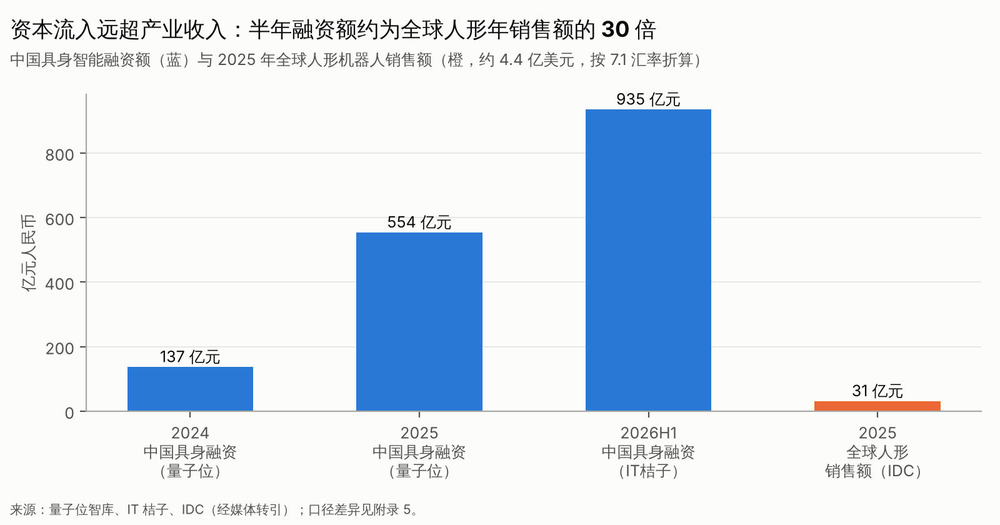

# 报告说明

**研究对象**：具身智能全产业链，涵盖人形机器人、通用移动操作机器人、机器人基础模型及其上下游。
**信息截止**：2026 年 10 月 21 日。少数关键事件更新至 10 月 30 日，均注明日期，例如特斯拉 2026Q3 财报会、GXO 扩大部署。
**定位**：这份报告服务于中国一级市场的投资决策，研究资源向产业、客户、竞争、资本和估值倾斜。技术只在影响产业判断时深入展开。

**证据等级**（全文以〔A〕〔B〕〔C〕〔D〕标注，并附来源编号 S01–S80，详见附录 9）：

- 〔A〕可核验的一手资料，或经过高质量独立验证的信息：交易所公告、政府文件、企业正式公告、IFR/统计局数据。
- 〔B〕可靠的二手来源，并有交叉佐证：主流财经媒体对财报、招股书的解读，以及第三方研究机构数据的转引。
- 〔C〕企业单方披露、单一来源或匿名信源。
- 〔D〕本报告的研究假设、推断或情景预测。

**成熟度五级**（沿用委托书定义）：

- L1：实验室论文与单场景演示。
- L2：受控条件下的持续运行。
- L3：真实客户现场试点。
- L4：可重复、可付费的商业部署。
- L5：可规模化复制的成熟产品。

**口径纪律**：下面几组概念在文中严格区分。

- 出货、销量、交付、部署、有效运行。
- 意向订单、框架协议、正式合同、确认收入、回款。
- 融资宣布、交割到账。
- 估值、市值。
- 产量、出货。

**研究局限**：本研究环境的网络访问受白名单限制，多数网页无法直接打开原文，核验主要依靠检索引擎返回的原文摘录和多源比对。凡未能逐字核对的数字，都已降级标注。所有估值、TCO 和回报模型的参数都属示例性研究假设〔D〕，不代表任何企业的真实财务信息。本报告不构成投资建议。

**配套交付**：

- 数据底表：`data/具身智能投资研究_数据底表_2026-10.xlsx`，共 17 张表，每张另附 CSV。
- 模型代码：`scripts/models.py`，可复算本报告全部模型数值。

---

# 投资决策摘要

## 一句话结论

具身智能正处在一个错配期：技术能力在快速进步，资本极度充裕，但真实的生产性需求还没有形成。从 2026 年下半年起，整机赛道正由"资本扩张期"转入"商业验证期"。今后三年，这个行业的回报将由**收入质量**定价，而不是由**技术叙事**定价。最好的机会不在"再投一家通用人形公司"，而在三类资产：

1. 估值重置后的头部平台，以结构化条款进入；
2. 有工艺壁垒的精密部件和工具链，也就是"卖铲子"；
3. 已经跑通任务闭环的场景型公司，而且不拘泥于人形形态。

## 十个必须知道的事实

1. **产业规模仍然很小**。2025 年全球人形机器人出货约 1.8 万台，销售额约 4.4 亿美元〔B，S13〕。2026 年上半年出货超过 2.2 万台，前五名都是中国厂商，合计占 86%〔B，S14〕。工信部口径下，中国 2025 年人形产量约 2 万台，2026 年上半年超过 4 万台〔B，S19〕。**产量明显高于出货**，这本身就是需要追踪的风险信号。
2. **买家主要不是工厂**。2025 年超过八成出货流向文娱和科研〔C，S56〕。2026 年上半年国内公开中标金额中，教育科研占 55.5%，政府及国资平台占 20.6%，工业企业只占 21.1%〔C，S56〕。
3. **资本远远跑在收入前面**。中国具身智能融资额在 2025 年约为 329–554 亿元（因统计口径而异），仅 2026 年上半年就达到 935 亿元〔B，S23/S25〕。半年的融资额大约是全球人形年销售额的 **30 倍**（见图 1）。
4. **已经出现盈利样本，但它的需求是"研究工具"**。宇树 2025 年营收 17.08 亿元，主营毛利率约 60%，实现盈利〔B，S01〕。到 2026 年上半年，增速已从 +335% 降到 +48.5%〔B，S07〕。优必选 2025 年营收 20.01 亿元，仍在亏损，大额订单多来自政府的数据采集中心项目〔B，S08/S11〕。
5. **客户侧还没有 ROI**。全球最大的第三方物流商 GXO 完成了 45 次人形试点，CEO 表示"尚未实现 ROI"；它 2026 年计划部署约 2 万台机器人，其中**没有一台是人形**〔B，S36/S37〕。Agility 2025 年收入只有 180 万美元，但手握超过 3 亿美元的里程碑式订单〔B，S35〕。
6. **二级市场完成了第一次价格发现**。宇树以 219 倍发行市盈率上市，首日开盘市值约 4,449 亿元，到 9 月中旬已较开盘高点回撤约 53%〔B，S02/S06〕。据报道，证监会已通过窗口指导提高人形企业的 IPO 门槛〔B，S55〕。智元的港股 IPO 因新一轮融资而暂缓〔C，S16〕。
7. **美国开始分化**。Figure 估值 390 亿美元，收入极少〔B，S32〕。Skild 估值 140 亿美元以上，自称收入运行率超过 1 亿美元〔B/C，S46/S47〕。1X 的洽谈估值从 100 亿美元的目标降到约 60 亿美元〔C，S44〕。
8. **能力瓶颈已经从"走"转到"稳定地做"**。运动控制已经商品化。开放环境下的整任务操作成功率只有 10%–60%，且口径各异〔C〕。宝马的 Figure 02 试点累计 1,250 运行小时，按公开数据推算，平均吞吐大约只有产线节拍需求的一半〔C→D，S33〕。
9. **成本**。本报告 BOM 模型给出的基准估计是：2026 年千台级批量的全尺寸工业人形，单台物料加装配约 **27 万元**，区间 10–54 万元。其中旋转关节、线性关节和灵巧手这"三大件"约占 73%，与券商口径一致〔D/C，S63〕。G1 类小尺寸人形的成本约 3.5 万元，售价 9.9 万元，由此推出的毛利率约 64%，与宇树披露的毛利率相互印证〔D〕。
10. **政策是一把双刃剑**。一方面，国家发改委在 2025 年 11 月提示了"泡沫风险"，指出整机企业已超过 150 家〔A，S21〕。另一方面，工信部和国资委的专项行动要求 2026 年底形成万台级的落地能力〔B，S20〕，万亿级的国家创业投资引导基金也已启动〔A，S22〕。在美国，联邦采购禁令法案和 GUARD Act 正在推进〔B，S72/S73〕。

## 五组结构性矛盾

| 矛盾 | 现状 | 决定胜负的变量 | 投资含义 |
|---|---|---|---|
| 资本规模与收入规模 | 半年融资约为全球年销售额 30 倍 | 订单向收入的转化率、复购率 | 后期估值透支；收入质量将成为估值锚 |
| 演示能力与部署能力 | 演示领先部署 1–3 年 | 人工接管率、看护配比、MTBF | 把"接管率"列为一票否决项 |
| 通用能力与场景经济性 | 2026 年人形在双班搬运中不回本 | 吞吐率 ≥70%，整机价格 ≤30 万元 | 优先投资形态中立、任务闭环的公司 |
| 政策订单与市场需求 | 国资约占公开招采金额 74%（转引） | 非政府收入占比 | 政府收入按一次性收入低倍数估值 |
| 一级估值与退出承接 | 证监会提高门槛，港股排队约 46 家 | 经常性收入、亏损收窄 | 设计多路径退出；以并购作为基准情景 |

## 分环节阶段判断（2026 年 10 月）

| 环节 | 所处阶段 | 判断依据 |
|---|---|---|
| 科研教育与文娱人形 | 成熟期早段（增速放缓、价格战） | 宇树增速回落；租赁日租从万元级跌到千元级〔B，S59〕 |
| 工业人形整机 | 商业验证早期 | 试点多，生产工位部署少，ROI 未达成 |
| 家庭通用人形 | 技术探索期 | 遥操作兜底，估值下修 |
| 机器人基础模型 | 技术探索期叠加资本扩张 | 开源密集，收入极少 |
| 核心零部件 | 量产导入期 | 订单增长，但均价下行、毛利承压〔B，S62〕 |
| 非人形移动操作与特种机器人 | 商业验证到早期规模化 | 四足巡检、AMR 已实现盈利〔A/B，S53/S77〕 |

## 投资机会优先级（详见第十三篇）

1. **★★★★★ 任务闭环的轮式移动操作和场景系统**，覆盖工业上下料、实验室、物流搬箱。这类资产确定性最高，进入估值以不超过 10–15 倍收入为宜。
2. **★★★★ 精密部件**：行星滚柱丝杠、高自由度灵巧手加触觉、六维力。用存量业务给估值托底，把人形需求当作期权。
3. **★★★★ 特种作业**：巡检、电力、危化、矿山。已有盈利样本，主要客户是国企，复购明确。
4. **★★★ 端侧计算平台和数据工具链**。受益于国产替代和部署规模增长，但要警惕被大厂和开源替代。
5. **★★★（看价格）头部整机或平台的重置估值轮次**。只在估值回落、并且有优先清算权与回购等结构化条款时参与。

**应当回避的方向**：

- 同质化的双足全尺寸整机新项目；
- 以政府数采中心或商演租赁为主要收入的企业；
- 估值超过 100 亿元、却没有第三方付费的纯模型公司；
- 家庭通用人形（最多只作小额期权）；
- 订单以框架协议为主、关联方收入占比高的企业。

## 估值与回报的关键结论（详见第十四篇）

按本报告的情景回报模型〔D〕：

- **整机 B 轮**：以 80 亿元投后估值进入，期望 MOIC 约 **0.73x**；入场估值降到 30 亿元时约 1.5x。
- **纯模型 A 轮**：以 40 亿元投后估值进入，平台化概率需要达到 20% 以上，期望 MOIC 才接近 2x。
- **已有真实客户的工业场景公司**：以 15 亿元进入，期望 MOIC 约 1.44x，而且分布更集中、下行更可控。

**结论**：在当前价格下，后期整机和纯模型项目的风险收益比不佳。超额回报来自两种情形：一是**估值重置后的入场**；二是**早期、低估值、但有任务闭环证据的项目**。

## 重大风险

- **下行风险**：泛化能力和可靠性在 2028 年前没有突破，行业进入悲观情景，出现大面积融资断档和整机出清（见第十二篇）；退出窗口持续收紧；订单造假或关联交易暴露，引发行业性信任危机。
- **上行风险**：VLA 或世界模型在 2027 年出现可靠性跃迁，同时特斯拉实现大规模量产，行业提前进入乐观情景。这种情况下，过度保守会让我们错过头部平台的超额收益。

## 未来三年的动态策略

| 时间段 | 市场状态（基准情景） | 策略 |
|---|---|---|
| 2026Q4–2027H1 | 估值分化、IPO 门槛提高、尾部融资断档 | 以尽调和建库为主；只投场景闭环与精密部件；为头部整机的重置轮次预留额度 |
| 2027H2–2028 | 工业 ROI 门槛开始被部分场景跨越，出清加速 | 加大对复购明确的场景公司的投入；参与并购整合；跟踪人形与轮式在同一任务上的 TCO |
| 2029 起 | 规模化与标准化，专业分工重新出现 | 布局标准化部件、运维与金融服务、机器人 OS 与车队管理 |

**每季度复核的触发指标**：

- 工业生产性收入占比；
- 1 人看护台数；
- 每小时人工接管次数；
- 订单向收入的转化率；
- 上市可比公司的估值/收入倍数；
- 特斯拉季度产量；
- 美国相关法案的进展。
