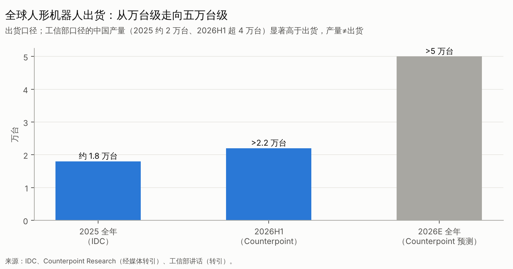

# 第二篇　全球产业实际发展水平：剥离宣传后的真实能力

## 2.1 核心问题：机器人今天到底能做什么，不能做什么

先给结论〔综合判断，B/C/D〕：

- **已经可靠能做的**：
    - 在平地与一般室外地形上稳定行走、跑跳和完成舞蹈动作（运动控制已商品化）；
    - 在结构化工位上，对已知物体做抓取放置；
    - 四足机器人做巡检；
    - 在受控展示环境中做导览和交互。
- **在试点中"能做但不够好"的**：
    - 工厂的料箱搬运、上下料、物料配送：速度慢于熟练工人，需要人员看护；
    - 物流搬箱：可以连续运行，但吞吐和可用率还不足以支撑 ROI；
    - 柔性物体操作，例如叠衣服：成功率可观，但速度慢、失败恢复差。
- **基本还做不到的**：
    - 陌生家庭里长时序家务的可靠完成；
    - 精细的五指装配；
    - 不靠人工接管、跨场景零样本的长期稳定运行；
    - 满足汽车总装线节拍与质量的规模化作业。

## 2.2 成熟度五级与代表企业定位

| 成熟度 | 定义 | 代表性证据（截至 2026-10） | 证据等级 |
|---|---|---|---|
| L5 规模化成熟产品 | 可规模化复制 | 科研教育与文娱人形（宇树 G1 等，年出货数千台、毛利约 60%）；四足巡检；仓储 AMR（极智嘉营收 31.71 亿元、经调整盈利） | A/B |
| L4 可重复付费部署 | 多客户、可付费、可重复 | 云深处四足巡检（2025 年营收 3.37 亿元、盈利）；优必选政府数采中心项目；Agility 在 9 个客户站点的 RaaS（规模小） | A/B |
| L3 客户现场试点 | 真实客户、真实现场 | 宝马 Figure（2025 年 Figure 02，2026 年 Figure 03 做物流作业）；优必选、智元在车厂和 3C 产线的实训与试点；GXO 45 次人形试点；银河通用零售"太空舱" | B/C |
| L2 受控持续运行 | 实验室或自有场地长时间运行 | 特斯拉内部工厂；1X NEO 内部家庭测试；北京人形创新中心 8 小时耐久测试 | C |
| L1 演示 | 单场景、可剪辑 | 大部分家庭场景、五指精细装配、长时序整任务演示 | — |

**关键观察**：同一家公司的不同产品、不同场景，往往处在不同成熟度。所以评价企业时**不能用一个成熟度标签概括**，必须**按收入来源逐项定级**。例如，宇树的科研教育业务属于 L5，工业业务大致在 L3；优必选的政府项目属于 L4，产线生产性部署多在 L3。

## 2.3 分能力维度的真实水平

| 能力维度 | 2026 年真实水平 | 主要证据 | 离商业化的差距 |
|---|---|---|---|
| 移动与平衡 | 成熟：仿真强化学习加零样本 sim2real 成为标配 | 跑跳、舞蹈、马拉松赛事普遍可完成 | 负载下的稳健性和跌倒后的安全仍需改进 |
| 导航 | 成熟：AMR 产业已验证 | 极智嘉等 | 人形借用即可 |
| 结构化抓放 | 接近可用：固定工位成功率可达 99% 级（多为公司口径） | 智元称在龙旗产线达 99.5%；千寻称在宁德时代超过 99%（C） | 节拍和换型速度 |
| 开放环境移动操作 | 早期：陌生家庭整任务成功率约 56%（Figure 自评）；BEHAVIOR 挑战赛冠军的完整成功率约 12% | 公司自评与学术赛事（C/B） | 长尾失败、误差累积 |
| 灵巧操作 | 早期：五指装配类任务成功率约 32%–44%（DeepMind 自报，C） | 特斯拉称手部是最难的机电问题（B，S29） | 硬件寿命与触觉 |
| 双臂协同 | 中等：叠衣、装箱等可演示 | 多家公司演示 | 速度与稳定性 |
| 长时序任务 | 早期：约 10–15 分钟级任务演示 | PI MEM 等（C） | 记忆、错误恢复 |
| 环境泛化 | 早期：在数十户陌生家庭中零样本测试 | Figure（C） | 第三方大样本验证缺失 |
| 人机交互 | 可用：大模型对话和指令理解 | — | 指令到动作的可靠映射 |
| 安全 | 早期：标准体系 2026 年才发布（B，S20） | — | 认证缺失 |
| 可靠性与维护 | 缺乏公开数据：几乎没有公司披露 MTBF | — | 这是**最重要的信息缺口** |
| 续航 | 约 2–4 小时（多数公司口径）；优必选 Walker S2 用自主换电规避（C） | — | 换电与调度 |

> **口径警告**：上表的成功率几乎都来自公司自评，任务定义、样本量和是否允许重试各不相同，**不可横向比较**。第三方大样本、盲测的数据非常稀缺。2026 年 6 月的 RoboArena 众包评测操纵事件，进一步暴露了评测的公信力问题〔C，见原技术报告第 41 章〕。

## 2.4 一个可验算的案例：宝马 Spartanburg 的 Figure 02 试点

公开数据〔C，S33〕：Figure 02 在宝马 Spartanburg 车身车间工作约 10–11 个月，累计运行 1,250 小时，装载 9 万多个零件，参与了 3 万多辆 X3 的生产。该工位节拍为 84 秒，每个节拍装载 3 个零件，装载动作本身用时 37 秒。

**本报告的推算**〔D，假设所有运行小时都用于同一任务〕：

- 平均吞吐 = 90,000 ÷ 1,250 ≈ **72 件/小时**；
- 产线需求 = 3 件 ÷ 84 秒 × 3,600 ≈ **129 件/小时**；
- 机器人平均吞吐约为节拍需求的 **56%**；
- 时间覆盖：1,250 小时 ÷ 约 220 个工作日 ≈ **每工作日约 5.7 小时**，远低于双班约 16 小时的覆盖。

**解读**：这是一次**成功的试点**——机器人真正在生产线上运行，而且有可审计的数字。但它离**经济性替代**还很远。按本报告的 TCO 模型，吞吐率低于 60%、时间覆盖不足一班的机器人，即使整机价格降到 20 万元，也很难在 5 年内回本（第六篇敏感性表）。Figure 后来把 Figure 02 退役，换成 Figure 03 做物流作业，这也说明硬件代际迭代本身就是部署成本的一部分。

**替代解释**：这个工位可能并非全时段交给机器人，而是有意安排人机混线。若如此，56% 低估了机器人的瞬时能力。不过对投资判断有意义的，恰恰是"**平均有效吞吐**"而不是"瞬时最佳速度"。

## 2.5 演示和部署之间的"四道鸿沟"

| 鸿沟 | 演示中 | 部署中 | 如何识破 |
|---|---|---|---|
| 1. 选择偏差 | 展示最好的一次 | 要求每一次 | 要求连续 30 次以上的不剪辑录像 |
| 2. 人工接管 | 遥操作或人工复位常不披露 | 接管就是成本 | 要求每小时接管次数与日志 |
| 3. 环境控制 | 光照、物体、布局都事先准备 | 每天都在变化 | 由投资方指定物体和场景 |
| 4. 时间尺度 | 几分钟 | 每天 16–24 小时、数月不间断 | 要求 MTBF 和可用率 |

**机制解释**：模型版本以月为单位迭代，整机代际以 18–36 个月为单位迭代。软件进步能立刻体现在演示里，却要等硬件、品控和服务网络跟上，才能体现在部署里。所以"**演示领先部署 1–3 年**"是结构性的，不是个别公司的诚信问题（第十六篇 T25）。

## 2.6 地区竞争地位对比

| 维度 | 中国 | 美国 | 欧洲 | 日本 | 韩国 |
|---|---|---|---|---|---|
| 前沿研究与基础模型 | 强，追赶中（开源与迭代速度快） | **最强**（PI、DeepMind、NVIDIA、Skild） | 中（学术强，商业弱） | 中弱 | 中弱 |
| 供应链与成本 | **最强**（BOM 约为非中国供应链的三分之一，B，S64） | 弱（依赖中国与亚洲供应链） | 中（精密部件强：舍弗勒等） | 强（精密减速器、伺服） | 中 |
| 整机出货 | **最强**（全球前五占 86%） | 弱（百台到千台级） | 弱 | 弱 | 中（现代/BD） |
| 商业落地 | 科研教育与政府项目多，工业试点多 | 物流和汽车试点，单客户深 | 少 | 少 | 集团内部消化（现代） |
| 资本资源 | 数量多、单笔大，国资占比高 | 单家估值最高 | 少 | 少 | 产业资本 |
| 地缘风险 | 对美出口受限（法案推进中） | 供应链受制于中国 | 中性 | 中性 | 中性 |

**判断**：中美在这个行业里是互补的不对称竞争。美国领先在**"脑"和"资本定价"**，中国领先在**"身体"和"出货"**。欧洲和日本主要是精密部件供应者，韩国则以现代集团的内部场景作为突破口。

## 2.7 反证检查

- **可能推翻"操作不可靠"判断的证据**：第三方大样本盲测显示，某个模型在陌生环境中整任务成功率超过 90%，同时接管率低于 0.1 次/小时。
- **可能被忽视的事实**：中国工厂里有大量"实训"部署，这些部署虽然不在生产工位上，但确实在积累真实数据。这些数据的价值可能被低估。
- **一旦发展不及预期，损失最大的**：估值主要靠演示视频支撑、没有第三方部署指标的公司。
