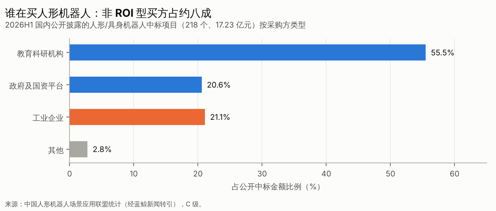
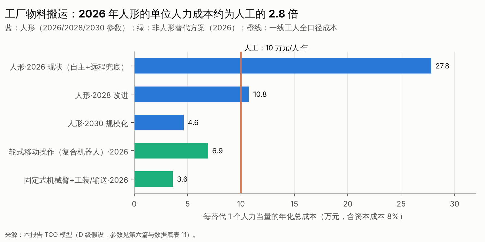

# 第六篇　下游应用场景、真实客户需求和商业模式

## 6.1 方法：从"场景想象力"改为"岗位、预算、替代方案"

评价一个场景，我们只问一个问题：**谁，会为哪项任务，用哪笔预算，在什么价格和性能下付费，而且会再买第二次？**

当前人形采购的结构说明，绝大多数购买并不是基于这个问题做出的：

- 2026 年上半年，国内公开中标中教育科研占 55.5%，政府及国资平台占 20.6%，工业企业只占 21.1%〔C，S56〕；
- 另一份基于 302 份招标书的分析称，企业订单仅占采购金额的约 7%〔C，S58〕。

## 6.2 场景总览

{{T:a4_scen}}

## 6.3 四个关键场景的"十问"

| 十问 | 汽车/3C 制造 | 仓储物流（搬箱/料箱） | 特种巡检 | 家庭服务 |
|---|---|---|---|---|
| 1. 具体做什么 | 上下料、物料配送（kitting）、简单装配辅助、质检搬运 | 料箱搬运、货架补货、拆码垛、装卸 | 读表、测温、气体检测、异常巡查 | 整理、清洁、洗衣、取放物品 |
| 2. 现在由谁做 | 一线工人；部分已由 AGV 和固定自动化完成 | 拣货工人；AMR、输送线、拆码垛机器人 | 巡检工；固定传感器、轨道巡检机器人 | 家庭成员、家政服务 |
| 3. 现方案的成本与痛点 | 一线工人全口径成本约 8–12 万元/人·年〔D，以统计局数据为锚，S67〕；招工难、流动率高、夜班难排 | 美国全口径人工约 30 美元/小时（Agility CEO 引用的基准）；旺季招工难 | 高危、夜间、偏远地区；人员安全风险 | 时间成本；美国家政约 25–40 美元/小时〔D〕 |
| 4. 机器人为何可能更优 | 可连续运行、不流失；旧产线不必改造 | 24 小时运行；可沿用人用料箱和货架 | 替代高危作业；数据可追溯 | 全天候在家 |
| 5. 为何可能更差 | 慢于节拍、需要看护；固定自动化更快更便宜 | 专用 AMR 和拆码垛已很成熟；人形吞吐不足 | 四足和轮式更便宜可靠，不需要人形 | 长尾最多，安全隐私要求最高 |
| 6. 商业化门槛 | 成功率 ≥99.5%；满足节拍（数十秒级）；1 人看护 ≥10 台 | 吞吐 ≥60% 人工；可用率 ≥90% | 可用率 ≥95%；防爆等认证 | 安全达到家电级；日均有效工作 ≥2 小时 |
| 7. 采购方、使用方、决策方 | 集团战略部门发起，工厂使用，财务审批；试点多由"创新预算"支付 | 运营 VP 发起，现场使用，财务按 ROI 审批 | 安全与运维部门；国企采购流程 | 家庭本人 |
| 8. 付费模式 | 一次性采购为主；RaaS 起步 | RaaS 为主（Agility 示意约 8,500 美元/月，C，S36） | 设备采购加服务 | 购买或订阅（1X：2 万美元或 499 美元/月，C，S42） |
| 9. TCO 与回本 | 2026 年不回本；约 2028 年 4–5 年回本；约 2030 年 1.5 年（模型） | 客户要在宣称替代量的约 51% 以上才获益（模型） | 四足 1–3 年（判断） | 订阅费难以覆盖价值（模型） |
| 10. 是否有预算与复购 | 有创新预算，复购少；现代 2.5 万台以上属集团内部规划（B，S41） | GXO 在扩大试点，但称尚未实现 ROI（B，S36） | **有**：云深处 2025 年营收 3.37 亿元、已盈利（A/B，S53） | 预订有，交付和复购数据缺失 |

**其余场景简评**：

- **3C 柔性产线**：节拍要求比汽车总装宽松，换型频繁，这正是固定自动化的痛点，所以是人形和移动操作在工业里**较早可能闭环**的子场景。不过客户（代工大厂）的议价能力极强，会持续压低价格。
- **科研教育**：这是当前最真实、最大的市场，宇树以约 60% 的毛利率在其中盈利。它的天花板取决于高校、职校和科研机构的设备预算，增速正在放缓（宇树 2026 年上半年增速为 +48.5%）。
- **政府数采中心与训练场**：属于一次性资本开支，与"实景实训"专项行动和地方财政节奏绑定（第十篇）。
- **商业服务与零售**：例如银河"太空舱"已进入 20 多个城市、百余家门店（公司口径，C）。它的竞争对手是**自助售货机和普通服务机器人**，后者成本低一个数量级。人形主要提供体验与展示价值，难以形成独立的 ROI 逻辑。
- **医疗康养**：康复器械已经商业化（例如傅利叶的康复业务）。人形陪护受医疗认证和安全约束，周期很长。
- **文娱商演与租赁**：日租从 2025 年初的约 1 万元，跌到 2026 年 10 月的 2,000–3,000 元，最低挂牌价仅 289 元/天〔B，S59〕。这是一个**已经出清的价格泡沫**。

## 6.4 单位经济模型：工厂物料搬运与上下料（双班）

**模型设定**〔D，示例性假设〕：

- 运行时间：双班、每天 16 小时、每年 300 天，即 4,800 小时；
- 用工成本：一线工人全口径 10 万元/人·年，以统计局 2025 年规模以上企业平均工资 10.6 万元为锚〔A，S67〕；
- 资本成本：8%；
- 替代的人力当量 = 2 班 × 吞吐率（相对熟练工）× 可用率；
- 看护人员成本：25 万元/人·年，按看护配比分摊到每台；
- 计入项目：整机价格、部署集成、维护（占整机价格的比例）、能源、软件订阅。

{{T:t_tco_factory}}

**解读**：

1. **2026 年的人形在双班搬运中不回本**：看护（1 人看护 5 台）加维护的年运营成本约 10.2 万元，已经超过它替代的人工（0.8 个人力当量，约 8 万元）。
2. **到 2028 年**，只要价格降到约 25 万元、吞吐达到约 70%、看护配比达到 1:10，静态回本期就能缩短到约 4.6 年，接近工业客户 3 年的心理门槛。
3. **今天就能回本的是非人形方案**：轮式移动操作约 2.7 年，固定自动化约 1.6 年。人形需要在**换型频繁、空间受限、改造成本高**的岗位上，才能证明自己的溢价。

### 敏感性一：整机价格 × 吞吐率 → 静态回本年数（2028 年其他参数）

{{T:t_sens_payback}}

> × 表示不回本或回本期超过 8 年。

### 敏感性二：看护配比 × 可用率 → 静态回本年数（整机 25 万元、吞吐 70%）

{{T:t_sens_supervision}}

**两张敏感性表的投资含义**：

- **吞吐率和看护配比对回本的影响，大于整机价格**。吞吐率从 50% 提到 85%，效果相当于整机价格从 40 万元降到 15 万元。
- 看护配比在 1:3 时，任何可用率下都不回本；提到 1:10 以后，经济性才开始成立。
- 所以尽调里的**"每小时接管次数"和"1 人看护台数"，比 BOM 更能决定商业化的距离**（第十五篇 Q02）。

## 6.5 仓储 RaaS：客户与供应商的两本账

**客户的账**：以 Agility 在 SEC 文件中的示意数字为锚，RaaS 约 8,500 美元/月（约 10.2 万美元/年），对应宣称替代约 20 万美元/年的全口径人工〔C，S36〕。

{{T:t_raas}}

客户获益的盈亏平衡点，是实际达成宣称替代量的 **约 51%**。GXO 在 45 次试点后仍称"尚未实现 ROI"〔B，S36〕，说明真实的达成率很可能低于这个阈值，或者部署、看护等隐性成本没有被计入。

**供应商的账**〔D〕：

{{T:t_raas_vendor}}

如果单台硬件成本在 10–15 万美元，RaaS 供应商在满负荷续约的前提下也需要约 **1.2–2.0 年**才能收回硬件，这还没有计入部署、看护和资金成本。在利用率不足、客户试点后不续约的情况下，RaaS 实际上是**用机器人公司的资产负债表为客户承担风险**（第十六篇 T21）。Agility 2025 年收入 180 万美元、经营亏损 1.4 亿美元〔B，S35〕，正是这一模式在早期的财务体现。

## 6.6 家庭场景：订阅经济是否成立

以 1X NEO 每月 499 美元为锚，用"有效工作小时 × 家政时薪 25 美元 × 质量折算"估算家庭获得的价值〔D〕：

{{T:t_home}}

只有当机器人每天有效工作约 **2 小时以上，且质量达到家政服务的 80% 左右**时，年化价值才能覆盖订阅费。按 Figure 自评的陌生家庭整任务成功率约 56%〔C〕，并考虑到家庭对安全和隐私的高要求，**2030 年前家庭通用人形难以形成规模化付费市场**（第十六篇 T16）。

还有一个关键问题：靠遥操作兜底的"专家模式"，成本会随用户数线性增长，因此无法形成软件式的规模经济。

## 6.7 人形形态真的必要吗？

| 条件 | 人形更优 | 轮式移动操作更优 | 固定臂或专用自动化更优 |
|---|---|---|---|
| 环境 | 有台阶、狭窄通道、为人设计且不能改造 | 平地、可规划通道 | 固定工位 |
| 任务变化 | 多任务、频繁切换 | 中等变化 | 单一、重复、高节拍 |
| 改造成本 | 改造极贵（老旧产线、跨楼层） | 中 | 改造可接受 |
| 节拍要求 | 低到中 | 中 | 高 |
| 安全 | 有专门区域 | 人机共融较容易 | 隔离 |
| 典型例子 | 跨楼层物料配送、旧车间多工位辅助 | 实验室样品转移、3C 物料配送、零售补货 | 焊装、冲压、码垛、分拣 |

**判断**〔D，中高置信度〕：2030 年前，工业具身需求的大部分会由**轮式移动操作和专用自动化**承接。人形有两个结构性机会：

1. **不能改造的人用环境**；
2. **规模经济外溢**——如果人形出货量远超其他形态，它可能凭成本成为通用平台。

第二条是乐观情景的关键假设，领先指标是**双足与轮式的 BOM 差价**。客户侧已经给出了初步答案：GXO 2026 年部署的 2 万台机器人里没有一台人形〔B，S37〕；亚马逊部署了超过 100 万台机器人，主力都不是人形〔C〕。

## 6.8 自下而上的市场空间：中国制造业

{{T:t_sam}}

**与自上而下预测的对照**：

- 高盛 2024 年预测 2035 年全球人形市场约 380 亿美元〔A，S68〕，2026 年又把 2035 年出货预测上调到约 650 万台〔C，S69〕；
- 摩根士丹利对 2050 年的预测达到"5 万亿美元"级（转引，C）。

本报告自下而上的中国制造业空间，是**成熟期每年约 40–400 亿元**。区间这么宽，正说明市场空间对"可替代岗位比例"和"人形相对轮式的占比"两个假设极度敏感。**投资决策不应以 2050 年的万亿美元叙事为基础，而应以 2028–2030 年可验证的场景回本为基础**。

## 6.9 哪些场景先闭环，哪些长期停留在试点

| 时间 | 可能实现经济闭环的场景 | 长期停留在政策试点或概念展示的场景 |
|---|---|---|
| 已闭环（2026） | 科研教育（非 ROI 预算）、四足巡检、仓储 AMR（非人形） | 文娱租赁（已崩盘）、商业导览 |
| 2027–2028 | 物流搬箱（轮式或人形，看可用率）、3C 柔性上下料、实验室自动化、危化与电力特种作业 | 政府数采中心（一次性） |
| 2029–2031 | 汽车总装辅助、跨楼层配送、部分康养 | 家庭通用人形（仍偏早） |
| 2031 以后 | 家庭窄域任务、通用服务 | — |

## 6.10 反证检查

- **推翻"工业不回本"的证据**：某工业客户公开披露，在正式工位部署 100 台以上人形，看护配比达到 1:20 以上，回本期在 3 年以内。
- **被忽视的替代方案**：中国制造业还有一个选项是**把产能转移到人工更便宜的地区**，这会削弱国内的劳动替代需求。另外，2025 年中国工业机器人安装量达到 35.4 万台、占全球 59%〔B，S65〕，说明传统自动化的渗透仍在快速推进，也在"吃掉"人形的潜在岗位。
- **发展不及预期时损失最大的**：收入依赖政府数采中心和文娱的整机企业，以及按"劳动替代万亿市场"定价的后期项目。
