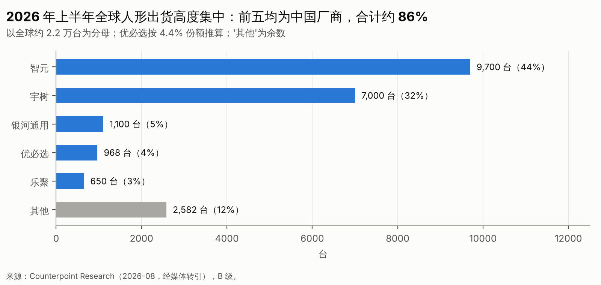
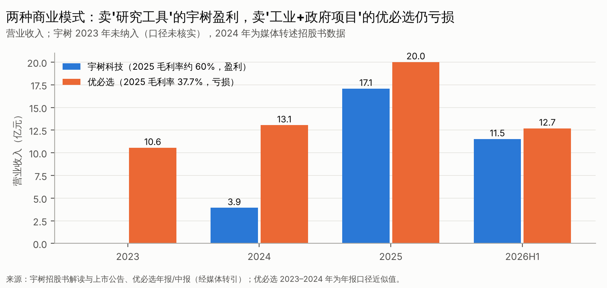

# 第八篇　全球与中国竞争格局、代表公司与动态身位

> 全部 64 家企业和机构的图谱见附录 1 与数据底表 01。本篇对最重要的 14 家（组）做深入分析，并建立一个可解释的竞争身位矩阵。
> 
> 原则：**不按融资规模、论文数量或宣传视频排名**。每家公司的信息分为三类：公司披露、第三方验证、研究推断。

## 8.1 竞争身位矩阵（1–5 分，研究判断〔D〕）

| 公司 | 技术与系统能力 | 硬件与制造 | 商业化证据（收入质量） | 资本实力 | 数据与部署规模 | 当前阶段 | 一句话身位 |
|---|---|---|---|---|---|---|---|
| 宇树 | 3.5 | **5** | **4.5**（盈利、非 ROI 型） | 5（上市） | 4 | 科研市场 L5、工业 L3 | 全球成本与出货标杆，面临"从工具到劳动力"的转型考验 |
| 智元 | 4 | 4 | 3.5（收入快增，结构未审计） | 4.5 | **4.5** | L3–L4 | 出货第一、产品线最全的平台型选手，收入质量待验证 |
| 优必选 | 3 | 4 | 3（收入大但依赖政府项目、亏损） | 4（港股） | 3 | L3–L4 | 工业人形"政企渠道"型选手 |
| 银河通用 | 3.5 | 3.5 | 3（关联方质疑） | 4.5 | 3.5 | L3 | 轮式双臂与零售场景的代表 |
| 云深处 | 3 | 4 | **4.5**（盈利、国企复购） | 3.5 | 3 | L4 | 特种场景闭环样本 |
| 特斯拉 | 4.5 | 4（尚未量产验证） | 1.5（无外部收入） | 5 | 3（内部） | L2 | 潜在规模之王，时间表持续推迟 |
| Figure | **4.5** | 3.5 | 2 | 5 | 3 | L3 | 美国估值最高的整机，商业化证据薄 |
| Agility | 3.5 | 3.5 | 3（少量真实 RaaS，客户称未达 ROI） | 3.5（SPAC） | 3 | L3–L4 | 物流人形先行者，经济性尚未跑通 |
| BD（现代） | 4.5 | 4 | 3（Spot/Stretch 成熟；Atlas 集团内消化） | 5（集团） | 3 | Atlas L2–L3 | 有内部场景托底的稳健型选手 |
| 1X | 3.5 | 3 | 1.5 | 3（估值下修） | 2 | L2–L3 | 家庭路线的风向标 |
| Physical Intelligence | **5** | 1（不造本体） | 1.5 | 4.5 | 3.5 | L2 | 前沿模型标杆，商业模式待定 |
| Skild AI | 4 | 1 | 3（自称运行率超过 1 亿美元） | 5 | 3 | L3 | 美国唯一宣称规模收入的模型公司 |
| NVIDIA | 4.5 | — | **5**（工具链与芯片） | 5 | — | L5（工具） | "卖铲子"的平台 |
| 中国模型独角兽（星海图/千寻/它石/自变量） | 3.5–4 | 2–3 | 1.5–2 | 4–4.5 | 2.5–3 | L2–L3 | 资本密集，需要证明不可被开源替代 |

**评分说明**：

- "商业化证据"只看**收入质量**：是否非关联、是否已验收、是否复购、是否为生产性用途；不看订单金额。
- "资本实力"综合考虑现金储备、融资能力和退出通道。
- 分数用于比较相对位置，**不可用于加总排名**。

## 8.2 中国重点企业

### 宇树科技：唯一被二级市场完整定价的样本

- **业务**：人形（G1、H1、H2、R1）和四足。电机、关节自研，成本领先。
- **财务〔A/B，S01/S07〕**：
    - 2025 年营收 17.08 亿元（+335%），主营毛利率约 60.3%，人形出货超过 5,500 台；
    - 2026 年上半年营收 11.52 亿元（+48.5%），归母净利 2.74 亿元，扣非净利 2.44 亿元，同比下降 19.3%。
- **资本**：2026 年 8 月 19 日在科创板上市，发行价 150.80 元，发行市盈率 219 倍。首日开盘 1,100 元，到 9 月 18 日收盘 514.98 元〔B，S02/S06〕。
- **竞争优势（真）**：成本与供应链、产品迭代速度、开发者生态（全球最常用的研究平台之一）。
- **主要风险**：
    1. 需求以科研、教育、文娱为主，**增速已明显放缓**；
    2. 低价产品引发价格战（R1 降到 2.99 万元起）；
    3. 美国法案点名，海外收入面临政策风险〔B，S72/S73〕；
    4. 向工业劳动力市场转型需要另一套能力：交付、售后、行业 know-how。
- **投资者视角**：宇树证明了"**卖铲子给淘金者**"可以盈利。但它在 2,000 亿元左右的市值上，隐含的是"转型工业"的成功预期。

### 智元机器人：出货最大、布局最全，收入质量是关键未知数

- **业务**：多产品线（远征、灵犀、精灵等），自研 GO 系列模型和 Genie Envisioner 世界模型。2025 年取得上纬新材控制权〔B，S18〕。
- **规模〔B/C〕**：2026 年上半年出货约 9,700 台，全球份额约 43%〔B，S14〕。2025 年营收约 10.5 亿元（创始人口径）；知情人士称 2026 年预期约 45 亿元〔C，S17〕。
- **资本**：2026 年 4 月报道融资约 20 亿元、估值约 200 亿元；10 月报道新一轮估值约 500 亿元。港股 IPO 因 120 日规则暂缓〔C，S16〕。
- **关键问题**：
    - 出货的产品构成（大、中、小尺寸，轮式或双足）；
    - 收入的客户构成（政府数采、教育、工业）；
    - 毛利率与现金流。

  以上都还没有经过审计的公开披露。
- **判断**：在部署规模和数据回流上最有潜力形成飞轮。但 500 亿元估值约为 2026 年预期收入的 11 倍，**要求 45 亿元收入大部分来自可持续需求**。

### 优必选：工业人形的"政企渠道"模式

- **财务〔A/B，S08/S09〕**：
    - 2025 年营收 20.01 亿元，毛利率 37.7%；全尺寸人形收入 8.21 亿元、1,079 台；
    - 2026 年上半年营收 12.7 亿元（+104%），全尺寸 921 台，净亏 3.39 亿元。
- **订单结构**：大额订单多为地方政府的数据采集与训练中心，例如九江 1.43 亿元〔B，S11〕。按收入与台数推算，全尺寸隐含均价约 64–76 万元/台（含方案）〔D〕。
- **优势**：港股上市带来融资能力（多次配售），政企渠道强，工厂实训覆盖面广。
- **风险**：
    - 政府项目的一次性；
    - 亏损仍然较大；
    - 非全尺寸小机器人拉高了"销量"口径（2026 年上半年合计 16,123 台中仅 921 台为全尺寸）〔B，S09〕。

### 银河通用：轮式双臂与零售场景，关联方问题是 IPO 核心

- **业务**：Galbot G1 轮式双臂；GraspVLA 与仿真合成数据路线；银河"太空舱"零售。
- **规模〔B/C〕**：2026 年上半年出货超过 1,100 台，全球第三〔B，S14〕；太空舱在 20 多个城市、百余家门店〔C，S52〕。
- **资本**：2026 年 3 月融资 25 亿元，媒体称估值超过 200 亿元〔B/C〕。
- **核心问题**：最大客户宁德时代同时是其投资方。**股东客户与非关联客户的收入占比**是 IPO 审核和投资判断的关键〔C，S52〕。

### 云深处：特种场景闭环的样本

- 营收 2023–2025 年分别为 0.50、1.03、3.37 亿元，2025 年首次盈利〔A/B，S53〕。按募资额推算，IPO 前估值约 139 亿元，约为 2025 年营收的 41 倍。
- **意义**：证明了**非人形、单一场景、国企客户**可以形成可复制的盈利模式。它是"场景闭环"投资逻辑的现实参照。

## 8.3 海外重点企业

### 特斯拉 Optimus：潜在的规模之王，时间表的"惯性推迟者"

- **进展〔B，S29〕**：
    - 2026 年第三季度财报会称：弗里蒙特高产线已开始早期生产，设计产能为年化约 2 万台/周，爬坡至少需要一年，"斜率平缓且颠簸"；
    - 对外交付约从 2027 年底开始，先供工业客户；
    - AI5 芯片预计 2027 年 4 月左右集成；
    - 手部是最难的问题，管理层不提供单位成本目标。
- **历史**：V3 发布多次推迟〔C，S31〕。
- **判断**：一旦量产突破，特斯拉是唯一能在单一企业内实现百万台级学习曲线的玩家，会**重塑全球零部件需求和价格**。但它的时间表历史上系统性乐观，投资中国零部件不应以"特斯拉定点"为核心假设（第十六篇 T14）。

### Figure AI：美国估值最高的整机

- **资本**：C 轮投后估值 390 亿美元（2025 年 9 月）〔B，S32〕；2026 年有 395 亿美元 term sheet 的传闻〔C〕。
- **部署**：宝马试点（第二篇 2.4 节）；2026 年 7 月宣布第 1,000 台 Figure 03 下线〔C，S34〕；Helix 系列模型自研。
- **判断**：技术与组织能力一流，但**收入极少**。390 亿美元估值要求它在 2030 年前后具备数十亿美元的收入能力。它的风险与特斯拉相同：时间表风险，外加更高的资本消耗。

### Agility Robotics：物流人形的现实检验

- **财务〔B，S35〕**：2025 年收入 180 万美元，经营亏损 1.4 亿美元；里程碑式长期订单超过 3 亿美元；9 个客户站点。
- **资本**：拟以约 25 亿美元估值通过 SPAC 在纳斯达克上市（AGLT），预计募资 6.2 亿美元以上。
- **客户声音**：GXO 称 45 次人形试点尚未实现 ROI，但仍将 Digit 扩展到北卡和田纳西的两个仓库，2027 年初部署〔B，S36〕。
- **判断**：Agility 是"人形 RaaS"最好的公开样本。SPAC 完成后的股价，将是全球人形情绪的重要指标。

### Boston Dynamics（现代）：有内部场景托底

- **进展〔A/B，S40/S41〕**：量产版 Atlas 2026 年的交付已全部锁定给现代 RMAC 和 Google DeepMind；现代计划在美国工厂部署 2.5 万台以上，2028 年产能目标 3 万台/年，并在美自产 30 万台以上的执行器/年；Metaplant 的规模部署在 2028 年。
- **判断**：这是"**集团内部消化**"模式，订单兑现概率高于框架协议，但对外部市场的示范意义有限。它的垂直整合（自产执行器）对独立零部件企业不利。

### 1X Technologies：家庭路线的风向标

- NEO 售价 2 万美元或 499 美元/月；2026 年 4 月宣布全面量产（公司口径）；与 EQT 签有至多 1 万台的框架〔C，S42/S43〕。
- 2026 年 8 月报道软银洽购多数股权，估值约 60 亿美元，低于 2025 年寻求的 100 亿美元〔C，S44〕。
- **判断**：美国一级市场第一个明显的**估值下修信号**，对应的正是商业化最远的家庭场景。

### Physical Intelligence 与 Skild AI：两种模型公司的商业化尝试

- **PI**：以 56 亿美元估值融资 6 亿美元（2025 年 11 月）；2026 年 3 月报道洽谈以 110 亿美元以上估值融资 10 亿美元，尚未确认交割〔B，S45〕。前沿模型能力最强之一，开源上一代模型，已启动 API 测试（C）。商业模式仍在探索。
- **Skild**：以 140 亿美元以上估值完成 14 亿美元 C 轮（2026 年 1 月，软银领投）〔C，S46〕；2025 年未审计收入约 3,000 万美元，彭博称首个商业部署后 10 个月收入运行率超过 1 亿美元、客户 60 多家〔C，S47〕。**这是需要尽调核实口径的最关键数字**：收入中有多少是硬件转售，有多少是软件授权。
- **判断**：美国模型公司拥有中国同行没有的两样东西——**前沿能力的时间差**和**软件付费文化**。即便如此，商业模式也还没有定型。对中国纯模型公司，这是一个警示。

### NVIDIA：确定性最高的"卖铲子"者

- 端侧芯片（Jetson Thor）、仿真与世界模型（Isaac、Cosmos）、开源模型（GR00T）三位一体。被 Agility、BD、银河等采用〔B，S70〕。
- **判断**：NVIDIA 的开源模型**压低了模型层创业公司的溢价**，同时它的芯片面临出口管制，这为中国端侧计算替代留出了空间。

## 8.4 中国模型独角兽群组：星海图、千寻、它石、自变量、智平方

| 公司 | 最新融资与估值（C 级为主） | 特点 | 共同风险 |
|---|---|---|---|
| 星海图 | 2026 年 B 轮加 B+ 轮合计约 30 亿元，投后超过 200 亿元 | 模型加本体双线，开放数据 | 开源追赶、自建本体的资本消耗 |
| 千寻智能 | 2026 年上半年累计融资近 45 亿元，估值约 200 亿元 | 工业场景（宣称在宁德时代部署） | 评测公信力（RoboArena 事件） |
| 它石智航 | Pre-A 轮 4.55 亿美元（国内单轮纪录，B，S50） | 人类数据加触觉、世界模型 | "百万小时数据"为公司说法 |
| 自变量 | 估值约 100 亿元，累计融资超过 40 亿元 | 统一模型，投资方为互联网战略资本 | 收入极少 |
| 智平方 | 单一来源称约 200 亿元 | 工业场景 | 信息透明度低 |

**群组判断**〔D〕：

- 这批公司在 2026 年用约 12–18 个月完成了美国同行三到四年的估值爬升；
- 但它们的收入证据普遍弱于 Skild，开源压力却大于美国同行；
- 它们的未来取决于三件事：
    1. 能否与本体或场景深度绑定，形成部署回流；
    2. 能否在 2027–2028 年出现可审计的工业收入；
    3. 能否在退出门槛提高后，找到并购或上市的路径。

## 8.5 零部件代表：绿的谐波

- 2025 年营收 5.71 亿元（+47%），归母净利 1.24 亿元（+121%），销量 42.5 万台；2026 年上半年营收 3.49 亿元（+39%），毛利率降到 32.3%〔B，S62〕。
- **判断**：人形需求还没成为主要收入来源，**价格下行先于人形放量到来**。这是"零部件概念股估值高于基本面"的一个注脚，也是精密部件投资要以存量业务定价的原因。

## 8.6 反证检查

- **身位矩阵可能错误的地方**：
    - 我们可能低估了中国模型独角兽的工业部署（因为信息不透明）；
    - 也可能高估了宇树在工业市场转型上的难度。
- **容易被忽视的竞争者**：
    - 小米、小鹏等车企，拥有芯片、制造和内部场景；
    - 字节、阿里等大厂，可能在任何时点纵向整合；
    - 传统工业自动化企业（汇川、埃斯顿、越疆），拥有客户、渠道和交付能力。
- **行业不及预期时损失最大的**：估值在 200 亿元以上、以模型或数据叙事为主、缺乏可审计收入的公司。
