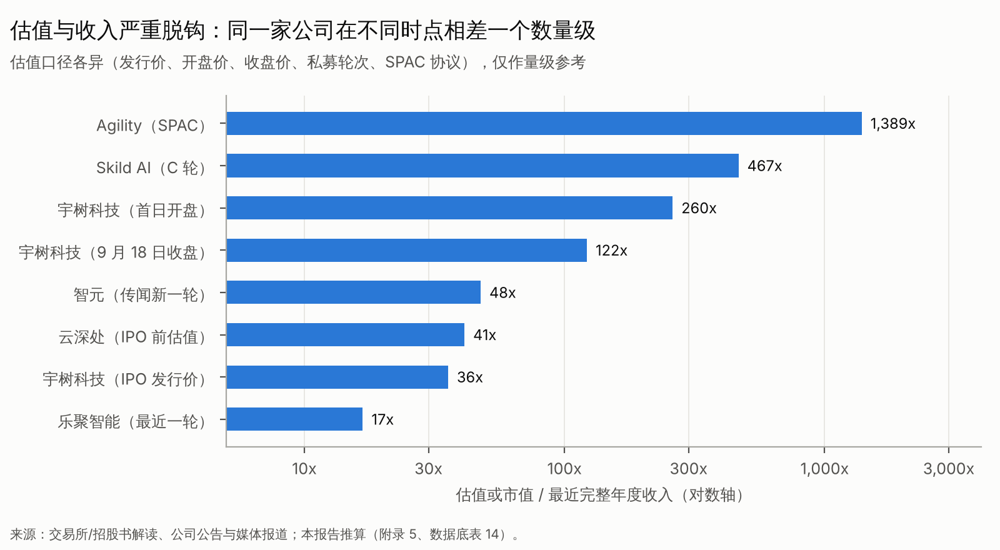

# 第九篇　投融资市场、资本周期与估值变化

## 9.1 先承认一件事：融资统计本身就是一个"口径灾难"

同一时期，不同机构给出的中国具身智能融资额可以相差 60% 以上：2025 年投中统计为 329 亿元，量子位统计为 554 亿元。2026 年前三季度，上奇产业通的统计（2,896 亿元）里还包含一笔约 771 亿元、性质未经核实的单笔事件〔C，S24〕。差异的来源主要有六个：

1. 赛道边界：是否包括零部件、传统工业机器人、自动驾驶相关公司；
2. 是否计入未披露金额的事件；
3. 是否把战略投资、政府产业基金出资、并购和定增计入"融资"；
4. "数亿元""超十亿元"等模糊金额如何取值；
5. 外币换算；
6. 同一轮次分批宣布时是否重复计算。

**本报告的处理**：不合成单一数字，而是并列展示各机构口径（下表），并且**只用同一机构的同比数据判断趋势**。

{{T:a2_fin_stats}}

**趋势判断（只用同口径比较）**：

- 投中口径：2024→2025 年，笔数 +144%，金额 +291%；
- 量子位口径：同期分别为 +158%、+304%；
- IT 桔子口径：2026 年上半年金额约为 2025 年上半年的 5 倍，笔数 +137%。

三家方向一致：**2024–2026 年上半年，融资额每年大约翻 2–4 倍，2026 年上半年见顶的可能性在上升**。7 月的不完全统计显示，金额环比下降 32.6%〔C〕。3 月和 6 月是单月高峰（IT 桔子）。

**全球人形口径**：PitchBook 统计 2025 年人形融资 61 亿美元/139 笔，2024 年为 15 亿美元/65 笔〔B，S27〕。按 2026 年上半年 935 亿元（约 132 亿美元）计算，**中国具身融资的半年规模已超过 PitchBook 统计的全球人形 2025 年全年规模的两倍**。不过两者口径不同（具身智能对人形），只能看量级。

## 9.2 关键融资与资本事件（2024–2026）

{{T:a2_fin_events}}

> 状态严格区分"已完成、已宣布、传闻、审核中"。同一轮次分批宣布时只计一次。

## 9.3 资本周期的四个阶段与投资逻辑的迁移

| 阶段 | 时间 | 定价锚 | 主力资金 | 典型行为 | 结局 |
|---|---|---|---|---|---|
| 信念期 | 2022–2023 | 团队背景 | 早期美元与人民币 VC | 天使、A 轮押注学术团队 | 奠定头部格局 |
| 验证期 | 2024 | 论文、演示、开源影响力 | VC、互联网大厂战投 | 估值翻倍 | 模型公司涌现 |
| 扩张期 | 2025–2026H1 | 出货、订单、"百亿俱乐部" | 国资、产业资本、头部 VC 联合 | 3 个月连续多轮、单轮十亿元级 | 估值进入 200–500 亿元级 |
| 验证与分化期 | 2026H2 起 | **收入质量、退出可行性** | 产业资本、二级市场 | 宇树上市及回撤、证监会窗口指导、港股 120 日规则 | 头部继续融资，尾部断档 |

## 9.4 不同类型资本的角色

| 资本类型 | 角色 | 行为特征 | 对行业的影响 |
|---|---|---|---|
| 人民币 VC/PE（高瓴、红杉中国、启明等） | 头部项目主导者 | 联合领投、快速跟进 | 推高估值、加快集中 |
| 美元基金 | 在中国项目中边缘化；在美国主导 | 关注地缘风险 | 中国项目的美元估值参照减少 |
| 国资与政府引导基金 | **2025–2026 年最重要的增量资金** | 返投要求、产业落地 | 托底估值、延迟出清；国家创投引导基金中央出资 1,000 亿元、目标万亿规模〔A，S22〕 |
| 产业资本（宁德时代、美团、TCL、车企、上汽等） | 战略协同、场景提供 | 股东即客户 | 带来场景，但也带来关联交易问题 |
| 互联网大厂（阿里、腾讯、字节、美团、小米） | 投资加自研 | 生态卡位 | 可能纵向整合，压缩独立模型公司空间 |
| 二级市场（A 股、港股） | 退出和定价 | 情绪化、高波动 | 宇树发行市盈率 219 倍；首日开盘约 260 倍市销率〔B〕 |

## 9.5 估值的演变与横截面

{{T:t_multiples}}

**三个观察**：

1. **同一家公司的估值，在两个月内波动了约 7 倍**。宇树从发行价对应的 610 亿元，涨到开盘的 4,449 亿元，又回到 9 月中旬的约 2,083 亿元。可见二级市场对人形的定价远未稳定。
2. **一级市场与二级市场存在倒挂风险**。200 亿元级的未上市整机或模型公司，多数没有宇树那样的盈利和毛利率，却要求接近的估值。
3. **美国估值更"纯粹地押未来"**：Agility 约 1,389 倍市销率，Skild 约 467 倍（按 2025 年收入）。中国上市样本（宇树）至少有利润支撑。

## 9.6 融资规模与真实业务进展的关系

| 指标 | 资本侧 | 业务侧 | 比值或解读 |
|---|---|---|---|
| 中国具身融资（2026H1） vs 全球人形销售额（2025） | 935 亿元 | 约 31 亿元（4.4 亿美元） | 约 30 倍 |
| Agility 订单 vs 收入 | 超过 3 亿美元（里程碑式） | 180 万美元（2025） | 收入约为订单的 0.6% |
| 优必选订单 vs 收入 | Walker 系列 2025 年订单约 13 亿元（公司口径） | 全尺寸收入 8.21 亿元 | 约 63%（部分订单跨年交付） |
| Figure 估值 vs 收入 | 390 亿美元 | 极少（媒体称上一年无收入，C） | — |
| 中国产量 vs 全球出货 | 中国 2026H1 产量超过 4 万台（工信部） | 全球出货超过 2.2 万台（Counterpoint） | **产量与出货的差距需要解释**：库存、口径差异，或含非人形/小型产品 |

**结论**：融资规模与真实业务进展之间**几乎没有正相关**。在 2025–2026 年，融资更多地反映**资本可得性和稀缺性溢价**，而不是商业化进度。这意味着当融资环境收紧时，估值的回撤空间会很大。

## 9.7 退出路径：窗口打开，正在收紧

| 路径 | 2026 年进展 | 门槛与风险 |
|---|---|---|
| 科创板 IPO | 宇树上市；云深处已受理（拟募资 25.03 亿元）〔A/B，S53〕 | 证监会窗口指导要求证明经常性收入、亏损收窄或真正创新〔B，S55〕 |
| 创业板（第四套标准） | 乐聚为首单受理〔A/B，S53〕 | 审核趋严 |
| 港股（含 18C） | 年内约 5 家机器人企业上市；约 46 家排队〔C，S78〕；智元因新融资受 120 日规则限制而暂缓〔C，S16〕 | 排队拥挤，估值低于 A 股 |
| 美国 SPAC | Agility 与 Churchill XI 合并（待完成）〔B，S35〕 | SPAC 后股价表现历来较差 |
| 控股上市公司 | 智元收购上纬新材 63.62%〔B，S18〕 | 监管对"借壳式"运作的关注 |
| 产业并购 | 尚少；预计 2027–2029 年随出清增加 | 买方以产业方为主，估值打折 |
| 老股转让 | 头部项目存在 | 价格信号重要 |

## 9.8 当前处于哪个阶段：分赛道判断

| 细分赛道 | 阶段 | 理由 |
|---|---|---|
| 同质化双足整机 | **资本扩张末期，局部过热** | 150 家以上企业、产品同质化（发改委）；尾部融资困难 |
| 头部整机和平台 | 资本扩张向商业验证过渡 | 估值仍在上升，但退出门槛提高 |
| 机器人基础模型 | 技术探索期叠加资本扩张 | 收入极少，估值高 |
| 精密零部件 | 量产导入期 | 订单真实增长，二级市场估值偏高 |
| 场景闭环的非人形机器人 | 商业验证到早期规模化 | 已有盈利样本，相对被忽视 |
| 数据服务 | 政策驱动的扩张期 | 补贴扩大供给 |
| 家庭人形 | 技术探索期，估值下修 | 1X 估值下修 |

## 9.9 泡沫在哪里，被忽视的又在哪里

**过度投资（泡沫风险高）**：

- 同质化全尺寸双足整机；
- 估值 100 亿元以上、没有第三方付费的纯模型公司；
- 文娱租赁和商演；
- 以政府数采中心为主要收入的整机；
- 讲"百万小时数据"故事但没有回流闭环的数据公司。

**相对被忽视（存在机会）**：

- 轮式移动操作和场景闭环系统（工业上下料、实验室、物流搬箱）；
- 特种作业机器人（巡检、电力、危化、矿山）；
- 精密部件里的工艺壁垒环节（丝杠、高端手、六维力）；
- 可靠性工程、运维、车队管理软件；
- 第三方评测与安全认证；
- 机器人金融，例如融资租赁、残值管理。

## 9.10 反证检查

- **"泡沫"判断的反面**：如果 2027 年工业 ROI 门槛在多个场景被跨越，今天的估值事后看可能是合理的。2020 年前后的电动车整车估值，就曾在几年后被收入证明。
- **"窗口收紧"的反面**：政策层面仍在鼓励硬科技上市，窗口可能在 2027 年重新放宽。如果我们因此过度保守，可能错过头部项目的 Pre-IPO 机会。
- **领先指标**：头部企业下一轮估值是否继续上调；老股转让的折价幅度；科创板和港股对人形企业的过会率。
