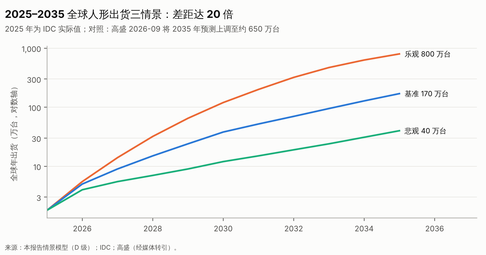

# 第十二篇　未来 3–10 年的产业发展情景

## 12.1 三种情景的设定逻辑

三种情景由两个**核心不确定性**组合而成：

1. **可靠性与泛化能力的突破速度**：开放环境整任务成功率、接管率、看护配比；
2. **成本下降速度**：单一企业的累计产量与学习率。

其他变量，包括政策、资本和地缘，作为放大器或抑制器叠加在上面。

| 情景 | 概率（判断） | 一句话描述 |
|---|---|---|
| 乐观 | 约 20% | 2027 年出现可靠性跃迁，特斯拉与中国头部实现十万台级量产，工业 ROI 在多场景跨越门槛 |
| 基准 | 约 55% | 技术渐进；2028 年前后物流、3C 等少数场景回本；行业出清后头部集中 |
| 悲观 | 约 25% | 泛化与可靠性长期难以突破，需求停留在科研、教育和政策项目，资本退潮导致大规模出清 |

## 12.2 三情景下的关键指标

{{T:t_scenarios}}

> 2025 年为 IDC 实际值（约 1.8 万台、约 4.4 亿美元）。2026 年三个情景的分歧较小，因为上半年实际出货已超过 2.2 万台。其余年份为情景假设〔D〕。均价按"小尺寸占比下降，全尺寸价格下降"的综合判断设定。
>
> 对照：高盛 2026 年把 2035 年出货预测上调到约 650 万台〔C，S69〕，介于本报告的基准情景（170 万台）与乐观情景（800 万台）之间。

## 12.3 三情景的完整叙事

| 维度 | 乐观 | 基准 | 悲观 |
|---|---|---|---|
| 技术能力 | 2027 年陌生环境整任务成功率超过 90%，接管率低于 0.1 次/小时；灵巧手寿命达标 | 2028 年结构化工业任务成功率超过 99%，开放环境约 70%–80%；看护配比约 1:10–1:20 | 2030 年开放环境仍低于 60%；工业部署依赖看护和场景改造 |
| 机器人成本（全尺寸 BOM） | 2030 年约 6–8 万元（约 1 万美元） | 2030 年约 10–15 万元 | 2030 年约 15–20 万元 |
| 部署规模（全球年出货） | 2030 年约 120 万台；2035 年约 800 万台 | 2030 年约 38 万台；2035 年约 170 万台 | 2030 年约 12 万台；2035 年约 40 万台 |
| 客户结构 | 工业与物流占 60% 以上，家庭开始起量 | 工业与物流约 40%–50%，科研教育约 25%，商业服务与其他为余 | 科研、教育、政策项目仍占 60% 以上 |
| 产业分工 | 平台化：头部整机加开放模型生态 | 垂直整合的头部 3–5 家，加场景专精者 | 尾部大规模出清，整合者也收缩 |
| 利润池 | 整机头部与平台（规模经济）；精密部件 | 精密部件、场景方案、头部整机 | 精密部件（依托工业存量）、科研教育整机 |
| 中国整机企业数 | 存活 20–30 家 | 存活约 10–20 家 | 存活不足 10 家 |
| 估值 | 头部估值被收入"消化" | 头部稳定，尾部下行 | 普遍下行，二级市场破发 |

## 12.4 敏感性：哪个变量最影响结局

| 变量 | 对 2030 年市场规模的弹性（判断） | 理由 |
|---|---|---|
| 看护配比与接管率 | **最高** | 决定 TCO 是否成立（第六篇敏感性表） |
| 吞吐率（相对熟练工） | 高 | 同上 |
| 单台成本 | 中高 | 前两个变量达标后，价格决定渗透速度 |
| 特斯拉量产节奏 | 中高（对全球零部件需求） | 单一企业可能占据大量份额 |
| 政策订单 | 中（对 2026–2028 年的中国） | 一次性，长期弹性低 |
| 地缘限制 | 中（对中国企业海外收入） | 市场分割 |

## 12.5 前置指标与触发事件（用于动态修正判断）

| 指标 | 乐观触发 | 基准区间 | 悲观触发 | 数据来源与频率 |
|---|---|---|---|---|
| 第三方大样本盲测的开放环境整任务成功率 | 2027 年超过 90% | 70%–85% | 2028 年仍低于 60% | 学术挑战赛、第三方评测，每半年 |
| 公开披露的看护配比 | 达到 1:50 | 1:10–1:20 | 低于 1:5 | 企业披露、客户访谈，每季度 |
| 工业企业采购占比（公开中标） | 2027 年超过 50% | 30%–50% | 低于 25% | 联盟统计、招标网，每季度 |
| 单一工业客户复购台数 | 出现千台级 | 百台级 | 只有十台级试点 | 公告、访谈，每季度 |
| 特斯拉 Optimus 周产量 | 2027 年底超过 5,000 台/周 | 1,000–5,000 台/周 | 低于 500 台/周 | 财报，每季度 |
| 全尺寸人形均价 | 2028 年低于 15 万元 | 15–30 万元 | 高于 30 万元 | 招标、报价，每季度 |
| 上市人形企业估值/收入倍数 | 维持 30 倍以上且收入高增长 | 10–30 倍 | 低于 10 倍且破发 | 行情，每月 |
| 一级市场下行轮数量 | 很少 | 局部出现 | 普遍 | 投资网络，每季度 |
| GXO、亚马逊等客户对人形的表态 | 宣布规模采购 | 扩大试点 | 停止试点 | 财报会，每季度 |
| 美国对中国机器人限制 | 明确豁免民用 | 采购禁令 | 全面进口禁令 | 法案、FCC 文件，实时 |

## 12.6 不强行量化的部分

以下指标缺乏可信的建模基础，本报告**只给方向、不给数字**：家庭人形的渗透率、2035 年各环节的利润率、具体企业 2030 年的市场份额、通用人工智能对机器人能力的跃迁时点。
